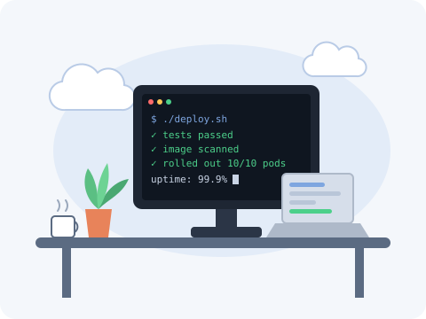

<i>Software engineer who likes her deploys boring and her uptime high.</i>

### 👋 Hey, I'm Snehal

- 🛠️ I love turning **slow, manual processes into fast, automated ones**
- 🚀 Took a **45-minute release down to under 6 minutes**. Nobody misses the old way.
- 🎓 Finishing my **M.S. in Information Systems** at **Northeastern**, Boston (Dec 2026)
- 🌱 Currently learning **Go and Kubernetes operators**
- 🎯 Looking for **Cloud, DevOps, Backend, or Full-Stack** roles
- 💬 Ask me about **Spring Boot, Kubernetes, CI/CD, Angular**
- ☁️ Certified on **Google Cloud (ACE)** and **Azure (AZ-104)**, because one cloud wasn't enough
- 📫 Reach me at **[snehalshinde3028@gmail.com](mailto:snehalshinde3028@gmail.com)**

 

### ✍️ Things I've written

- [Web Hosting on AWS Using Amazon EKS](https://shindesnehal277.medium.com/)
- [Deploying an Application Using Google Cloud](https://shindesnehal277.medium.com/)
- [Adobe Experience Manager with AWS Automation](https://shindesnehal277.medium.com/)
- [How Big MNCs Store and Manage Terabytes of Data at High Speed](https://shindesnehal277.medium.com/)

More on [Medium](https://shindesnehal277.medium.com/) →

### 🧰 Tools I use

  
   
  
   
  

### 🤝 Find me

  
  
  

