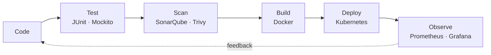

<div align="center">


</div>

```yaml
apiVersion: engineer/v1
kind: SoftwareEngineer
metadata:
  name: snehal-shinde
  location: Boston, MA
spec:
  role: [Cloud, DevOps, Platform, Backend, Full-Stack]
  experience: 3+ years shipping production systems
  education: M.S. Information Systems @ Northeastern (Dec 2026)
  certifications: [Google Cloud ACE, Azure AZ-104, Azure AZ-900]
  strengths:
    - microservices that handle real traffic
    - pipelines that make releases boring
    - frontends that load fast
status:
  availability: open to full-time roles
  replicas: 1   # but I scale well
```

### 📜 Production log

```text
2021–2024  TCS · core banking       ✔ ran 10+ Spring Boot services on GKE · 2M+ txns/day · 99.9% uptime
                                    ✔ Jenkins + Docker CI/CD: release time 45 min → under 6 min
                                    ✔ tuned PostgreSQL/Oracle queries: 65% faster
                                    ✔ automated an encryption workflow: ~4,800 hours saved per year
2026       Superstars Inc · web     ✔ predictive video preloading: 20% less buffering, 35% less bandwidth
                                    ✔ lazy loading + progressive images: 40% faster page loads
```

### 🚢 How I ship



### 🧰 Stack, by layer

| Layer | Tools |
|---|---|
| **Backend** |  |
| **Frontend** |  |
| **Data** |  |
| **Cloud** |  |
| **Delivery** |  |
| **Observe** |  |

### 🔭 Things I've built

<p>
  <a href="https://github.com/YOUR_GITHUB_USERNAME/REPO_1"></a>
  <a href="https://github.com/YOUR_GITHUB_USERNAME/REPO_2"></a>
  <a href="https://github.com/YOUR_GITHUB_USERNAME/REPO_3"></a>
</p>

- **AI Document Q&A**: ask questions, get answers grounded in your own documents (RAG on AWS ECS with pgvector)
- **DevSecOps Pipeline**: nothing reaches Kubernetes without passing code, image, and policy checks
- **Event-Driven Platform**: Kafka-connected microservices on EKS, fully instrumented

### 📫 Let's talk

<a href="https://www.linkedin.com/in/YOUR_LINKEDIN/"></a>
<a href="mailto:shinde.sne@northeastern.edu"></a>
<a href="YOUR_RESUME_LINK"></a>

<sub>Happy to talk about microservices, Kubernetes, or why a 45-minute release should never exist.</sub>
